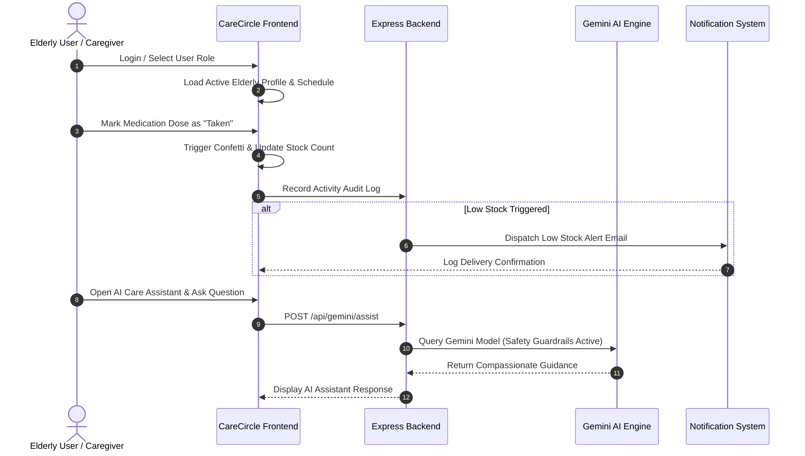

<div align="center">

# 🩺 CareCircle

### **Smarter Care. Safer Medication. Stronger Connections.**

[](https://react.dev/)
[](https://www.typescriptlang.org/)
[](https://tailwindcss.com/)
[](https://ai.google.dev/)
[](https://expressjs.com/)
[](LICENSE)

<p align="center">
  <b>An intelligent, collaborative healthcare management platform designed to help elderly individuals manage daily medications, doctor appointments, and healthcare routines while keeping authorized family members and caregivers informed.</b>
</p>

  <p align="center">
    <a href="#-project-overview">Overview</a> •
    <a href="#-problem-statement">Problem Statement</a> •
    <a href="#-our-solution">Solution</a> •
    <a href="#-key-features">Key Features</a> •
    <a href="#-system-architecture">Architecture</a> •
    <a href="#-application-workflow-diagram">Workflow</a> •
    <a href="#-technology-stack">Tech Stack</a> •
    <a href="#-installation-and-local-setup">Setup</a>
  </p>

</div>

---

## 📖 1. Project Overview

**CareCircle** is a production-grade, full-stack healthcare technology platform built to bridge the communication and coordination gap between elderly individuals, their families, and professional caregivers. 

Unlike traditional reminder apps that treat patients as passive recipients, CareCircle puts the elderly individual at the absolute center of all healthcare decisions. It combines intuitive senior-friendly UI design (high contrast, large typography, text-to-speech voice helpers) with robust server-side automation, Gemini AI intelligence, and secure role-based collaboration.

---

## ⚠️ 2. Problem Statement

As individuals age, managing daily health routines becomes increasingly complex. Seniors, families, and caregivers frequently face critical challenges:
- **Medication Non-Adherence**: Forgetting complex dosing schedules or taking incorrect quantities.
- **Appointment Friction**: Missing or poorly coordinated doctor consultations and specialist follow-ups.
- **Information Silos**: Family members and home-care nurses lacking real-time visibility into whether daily doses were actually taken.
- **Communication Delays**: Slow notification loops when medicine inventory is critically low or doses are missed.
- **Accessibility Barriers**: Standard healthcare apps built with cramped layouts, poor contrast, and confusing navigation unsuitable for seniors.

---

## 💡 3. Our Solution

CareCircle establishes a unified, shared healthcare ecosystem where:
- **Elderly Users** enjoy a simplified dashboard with large action buttons, voice reading assistance, and effortless one-tap dose confirmations.
- **Family Members** monitor adherence percentages in real time, receive automated email alerts for missed medications or upcoming doctor visits, and review shared care notes.
- **Caregivers** update medication schedules, record shift handovers, and coordinate care across teams without exposing unrelated private data.

---

## ✨ 4. Key Features

| Feature Category | Description & Practical Value | Implementation Status |
| :--- | :--- | :--- |
| **Role-Based Authentication** | Secure role selector and authentication supporting Elderly, Family, and Caregiver accounts. | ✅ Fully Implemented |
| **Elderly Healthcare Profiles** | Personalized profiles storing age, blood group, medical conditions, and emergency contacts. | ✅ Fully Implemented |
| **Medication Inventory** | Add, edit, and track medicines with dosage, frequency, timings, doctor details, and stock counts. | ✅ Fully Implemented |
| **Daily Medication Schedule** | Hourly schedule breakdown with status tracking (`upcoming`, `due_now`, `taken`, `skipped`). | ✅ Fully Implemented |
| **One-Tap Adherence Confirmation** | Simple confirmation action with celebratory confetti animations and automatic stock reduction. | ✅ Fully Implemented |
| **Low Stock Alerts** | Automatic inventory monitoring triggering alerts when stock reaches configured thresholds. | ✅ Fully Implemented |
| **Doctor Appointment Management** | Book, view, and cancel consultations with doctors, specializations, hospitals, and locations. | ✅ Fully Implemented |
| **Family & Caregiver Collaboration** | Connect team members, manage granular permissions, and issue secure 6-digit passcodes. | ✅ Fully Implemented |
| **AI Care Assistant (Gemini AI)** | Server-side Gemini AI integration providing routine summaries and assistant Q&A. | ✅ Fully Implemented |
| **Smart Adherence Insights** | AI-powered analysis of adherence history and missed-dose patterns. | ✅ Fully Implemented |
| **Intelligent Care Handover** | Shift note summarization for incoming nursing and family care teams. | ✅ Fully Implemented |
| **Email Reminder Simulator** | Backend Express endpoint simulating resilient email dispatches with delivery IDs. | ✅ Fully Implemented |
| **Care Activity Timeline** | Real-time audit log tracking who confirmed doses, added notes, or updated appointments. | ✅ Fully Implemented |
| **Senior Accessibility** | High-contrast toggle, large text scaling (A+), and screen text-to-speech reader helpers. | ✅ Fully Implemented |

---

## 🚀 5. What Makes CareCircle Innovative?

1. **Patient-Centric Sovereignty**: The elderly individual retains complete visibility and control over their routine while empowering family oversight.
2. **Collaborative Health Ecosystem**: Real-time synchronization ensures that when a caregiver or elderly user confirms a dose, family members instantly see the update.
3. **Gemini AI Healthcare Intelligence**: Goes beyond basic reminders by analyzing adherence trends and generating doctor discussion questions.
4. **Passcode-Based Secure Invitations**: Generates temporary 6-digit passcodes with expiration for safe care circle expansion.
5. **Universal Accessibility**: Built from the ground up for elderly users with zero friction.

---

## 🏛️ 6. System Architecture

CareCircle is architected as a full-stack React single-page application powered by an Express backend server running Vite middleware. The platform integrates React 19, TypeScript, and Tailwind CSS on the frontend with a secure Express API routing layer, Google GenAI SDK for AI intelligence, and robust session and state management.

---

## ➿ 7. Application Workflow Diagram



---

## 📦 8. Technology Stack

| Category | Technology | Purpose & Role |
| :--- | :--- | :--- |
| **Frontend Framework** | React 19 | Component-based UI rendering and state reactivity |
| **Language** | TypeScript 7.0 | Type safety across client and server modules |
| **Styling** | Tailwind CSS 4.3 | Utility-first modern responsive styling |
| **Icons** | Lucide React | Clean healthcare and UI iconography |
| **Animations** | Motion & Canvas Confetti | Delightful UI transitions and dose confirmation feedback |
| **Backend** | Express 4.21 | REST API routing and server-side logic |
| **AI Integration** | `@google/genai` (v2.4.0) | Server-side LLM calls for assistant, insights, and handover |
| **Build Tool** | Vite 8.3 | Ultra-fast development bundling and HMR |
| **Development** | TSX | TypeScript execution runtime for Express server |

---

## 🛠️ 9. Installation and Local Setup

Follow these steps to set up CareCircle locally on your machine:

### Prerequisites
- Node.js (v18 or higher recommended)
- npm or yarn

### Step 1: Clone the Repository
```bash
git clone https://github.com/your-username/carecircle.git
cd carecircle
```

### Step 2: Install Dependencies
```bash
npm install
```

### Step 3: Configure Environment Variables
Create a `.env` file in the root directory based on `.env.example`:
```env
# GEMINI_API_KEY: Required for Gemini AI API calls.
GEMINI_API_KEY="your_gemini_api_key_here"

# PORT: Server port (defaults to 3000)
PORT=3000
```

### Step 4: Run Development Server
```bash
npm run dev
```
Open your browser and navigate to `http://localhost:3000`.

### Step 5: Production Build
```bash
npm run build
npm start
```

---

## 🗂️ 10. Project Directory Structure

```text
carecircle/
├── server.ts                 # Express backend & Gemini API endpoints
├── package.json              # Project dependencies and scripts
├── tsconfig.json             # TypeScript configuration
├── vite.config.ts            # Vite bundler configuration
├── index.html                # HTML entry point with metadata
├── metadata.json             # AI Studio applet capabilities metadata
├── .env.example              # Environment variables template
└── src/
    ├── App.tsx               # Root component and layout wiring
    ├── main.tsx              # React DOM entry point
    ├── index.css             # Tailwind CSS imports
    ├── types.ts              # TypeScript interfaces and types
    ├── mockData.ts           # Pre-loaded realistic sample data
    ├── context/
    │   └── AppContext.tsx    # Global state management & actions
    ├── components/
    │   ├── Navbar.tsx        # Top navigation & accessibility controls
    │   ├── Sidebar.tsx       # Desktop navigation across all 16 views
    │   ├── AuthModal.tsx     # Role selector & login modal
    │   ├── InvitationModal.tsx # 6-digit passcode verification modal
    │   ├── AddMedicationModal.tsx # Add/edit medication modal
    │   └── AddAppointmentModal.tsx # Add appointment modal
    └── pages/
        ├── LandingPage.tsx   # Welcome overview page
        ├── Dashboard.tsx     # Main senior-friendly dashboard
        ├── MedicationsPage.tsx # Medication inventory & stock tracker
        ├── SchedulePage.tsx  # Daily medication timeline & confirmation
        ├── AdherenceCalendarPage.tsx # Streak and adherence calendar
        ├── AppointmentsPage.tsx # Doctor consultation management
        ├── CollaborationPage.tsx # Family & caregiver member manager
        ├── AiAssistantPage.tsx # Gemini AI chat, insights & handover
        ├── NotificationsPage.tsx # Email delivery history & test dispatch
        ├── AnalyticsPage.tsx # Adherence metrics & stock charts
        ├── ProfileSettingsPage.tsx # Healthcare profile & accessibility
        └── TimelinePage.tsx  # Shared activity audit timeline
```

---

## 👥 11. User Roles & Functionality Matrix

| Capability | Elderly User (`elderly`) | Family Member (`family`) | Caregiver (`caregiver`) |
| :--- | :---: | :---: | :---: |
| View Health Profile & Schedule | ✅ | ✅ | ✅ |
| Confirm Medication Doses | ✅ | ❌ | ✅ |
| Add / Edit Medications | ⚠️ (Depends on permissions) | ✅ | ✅ |
| Book / Manage Appointments | ⚠️ (Depends on permissions) | ✅ | ✅ |
| Invite Family / Caregivers | ✅ | ⚠️ (If permitted) | ❌ |
| View Activity Timeline | ✅ | ✅ | ✅ |
| Use AI Care Assistant | ✅ | ✅ | ✅ |

---

## 📄 12. License

Distributed under the **Apache 2.0 License**. See [LICENSE](LICENSE) for more details.

---

<div align="center">
  <p><b>CareCircle</b> • Smarter Care. Safer Medication. Stronger Connections.</p>
</div>
